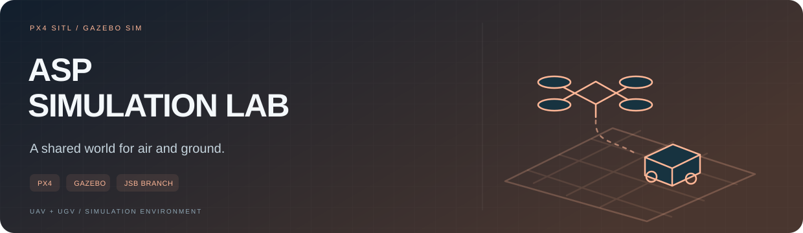

<p></p>

**공중과 지상의 로봇을 같은 시뮬레이션 월드에서 실험합니다.** PX4-Autopilot 기반 ASP 환경을 바탕으로 Gazebo 모델·토픽과 ROS 2 연동을 수정·확장한 프로젝트입니다.

<p><a href="https://github.com/subin11111/asp/tree/jsb"><b>작업 코드 · jsb</b></a> &nbsp; / &nbsp; <a href="https://github.com/subin11111/asp/blob/jsb/README.md"><b>설치·실행 문서</b></a> &nbsp; / &nbsp; <a href="https://github.com/subin11111/asp_ws"><b>ROS 2 워크스페이스</b></a> &nbsp; / &nbsp; <a href="https://github.com/chan-1207/PX4-Autopilot_ASP"><b>원본 환경</b></a></p>

<table><tr><td width="33%" valign="top"><b>SIMULATE</b><br><sub>PX4 SITL + Gazebo Sim</sub></td><td width="33%" valign="top"><b>SHARE A WORLD</b><br><sub>UAV·UGV·카메라·LiDAR</sub></td><td width="33%" valign="top"><b>CONNECT</b><br><sub>모델·명령 토픽과 ROS 2 연결</sub></td></tr></table>

---

# ASP · PX4 / Gazebo Simulation

## 작업 브랜치

**시뮬레이터 소스와 개발 문서는 [`jsb` 브랜치](https://github.com/subin11111/asp/tree/jsb)에 있습니다.** 이 `main` 브랜치는 프로젝트 입구와 관련 저장소 안내를 제공합니다.

## 어떤 작업인가요?

UAV `x500_gimbal_0`와 UGV `X1_asp`가 같은 Gazebo 월드에서 동작하도록 구성합니다. 모델 이름과 DiffDrive 명령·상태 토픽을 맞추고, 센서와 ROS 2 제어 인터페이스를 연결하는 시뮬레이션 실험입니다.

| 이 저장소 | 연계 저장소 |
| --- | --- |
| **[`asp/jsb`](https://github.com/subin11111/asp/tree/jsb)** — PX4·Gazebo 환경, 월드·모델·토픽 구성 | **[`asp_ws`](https://github.com/subin11111/asp_ws)** — ROS 2 미션·제어·브리지 |

## 시작하는 순서

1. [`jsb`의 README](https://github.com/subin11111/asp/blob/jsb/README.md)에서 의존성과 환경 구성을 확인합니다.
2. 작업 브랜치를 선택해 시뮬레이터를 준비합니다.
3. [`asp_ws` 실행 문서](https://github.com/subin11111/asp_ws#실행-방법)를 따라 ROS 2 쪽 미션·브리지를 연결합니다.

```bash
git clone --branch jsb https://github.com/subin11111/asp.git
cd asp
```

위 명령은 소스를 가져오는 단계입니다. PX4 빌드와 Gazebo·ROS 2 실행에는 작업 브랜치 문서의 의존성 준비가 필요합니다.

## 기술과 출처

`PX4 SITL` · `Gazebo Sim` · `ROS 2` · `UAV / UGV` · `SDF` · `C++ / Python`

기반 환경은 [chan-1207/PX4-Autopilot_ASP](https://github.com/chan-1207/PX4-Autopilot_ASP)입니다. 개인 작업은 해당 환경 위에서 기록한 수정·확장과 연동 실험이며, PX4 전체를 직접 개발한 것으로 소개하지 않습니다. 원본 라이선스는 작업 브랜치의 [LICENSE](https://github.com/subin11111/asp/blob/jsb/LICENSE)를 따릅니다.
